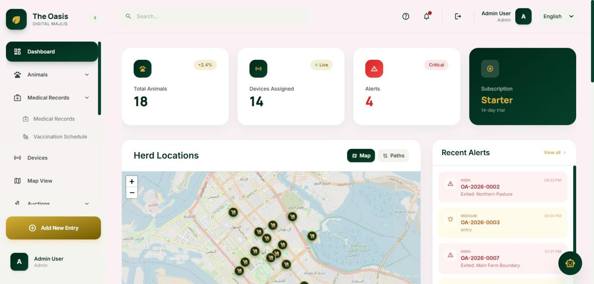
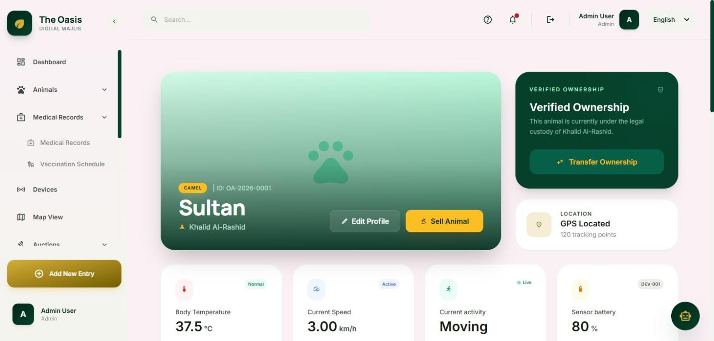
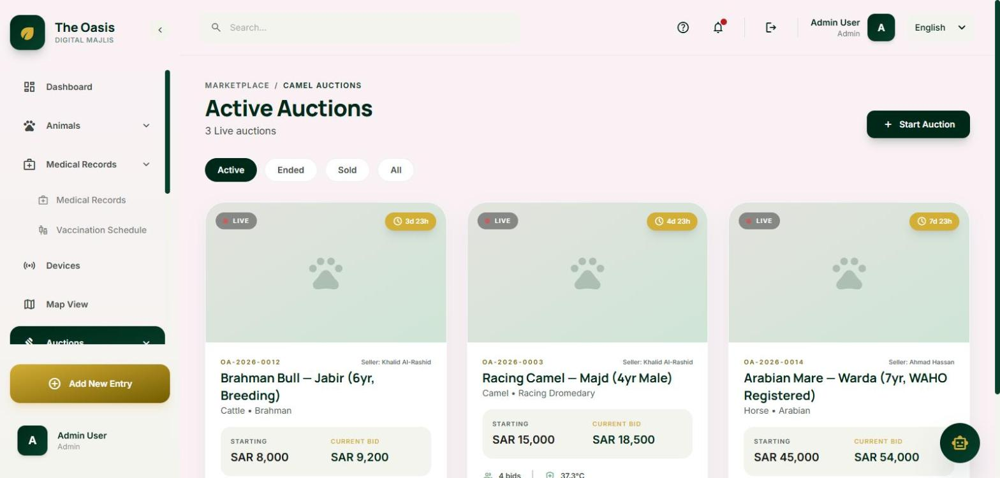
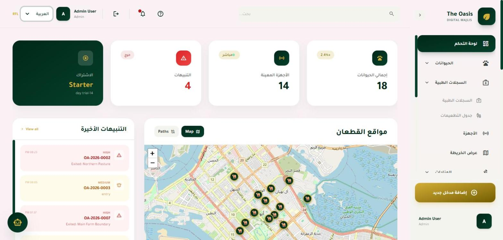
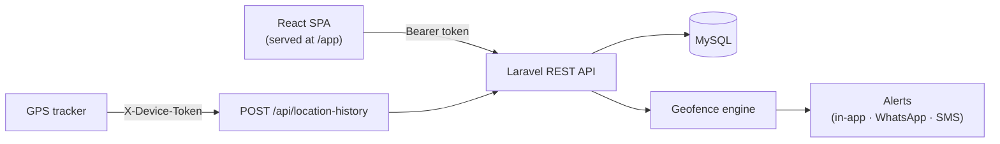

# Livestock Tracking Platform

[](https://github.com/YoussefGaalal/livestock-tracking-platform/actions/workflows/ci.yml)

A multi-tenant livestock management platform: GPS-tracked herds on a live map, geofence alerts, health and vaccination records, team roles, and a built-in auction marketplace — in English, Arabic, Urdu and Basque, with full right-to-left support.

Built with **Laravel 11** (REST API) and **React 18** (single-page app), backed by **MySQL 8**.



| Animal profile | Auction marketplace | Arabic (RTL) |
|---|---|---|
|  |  |  |

---

## Features

- **Live herd tracking** — GPS trackers report positions; animals appear on a Leaflet map with 30-day movement trails.
- **Geofencing** — draw polygon zones (pasture, water point, restricted area); entry/exit events raise alerts with severity.
- **Health records** — medical history, vaccination schedules with due/overdue states, per-animal health benchmarks.
- **Auctions** — list an animal, take bids, close the sale, then a payment workflow: winner uploads proof → admin verifies → ownership transfers automatically.
- **Teams & roles** — Admin, Owner, Manager, Shepherd and Doctor, each with a distinct permission set (Spatie Permission).
- **Subscriptions** — tiered plans that cap animals, devices and team members.
- **Internationalisation** — 4 languages, RTL layouts for Arabic and Urdu, admin-editable translations.
- **Admin console** — platform settings, integrations (SMTP, Stripe, WhatsApp, Twilio, Gemini) and data exports.

## Tech stack

| Layer | Technology |
|---|---|
| API | Laravel 11 · PHP 8.4 · Sanctum (token auth) · Spatie Permission |
| Web app | React 18 · Vite · Tailwind CSS · React Router · Leaflet · i18next |
| Database | MySQL 8 |
| Testing | PHPUnit (100+ feature tests) · Vitest · ESLint |
| CI / deploy | GitHub Actions · Railway (Nixpacks) |

## Architecture



- One Laravel app serves both the JSON API (`/api/*`) and the compiled React app (`/app/*`), so production is a single same-origin deployment.
- Users authenticate with Sanctum bearer tokens; every request's identity comes from the token, and role checks run in both route middleware and controllers.
- Trackers authenticate separately with per-device tokens, stored hashed.

## Security

- Per-device API tokens (SHA-256 hashed) for GPS ingestion; a device can only report its own position.
- Role-gated admin routes and admin-only data exports; tenants can only see their own herd, team and records.
- Rate limiting on login, registration and password-reset endpoints.
- Integration secrets are never returned to the browser — the settings API returns masked values.
- No raw card data is accepted by the API; card checkout runs in Stripe test mode only.
- Demo accounts are never seeded in production unless `DEMO_USER_PASSWORD` is set.
- Regression tests cover these rules (`tests/Feature/SecurityTest.php`, `DeviceIngestionTest.php`).

## Getting started

### Prerequisites

PHP 8.4 with Composer, Node.js 20.19+ (or 22), and MySQL 8.

### Setup

```bash
cd backend
composer install
npm ci
cp .env.example .env            # then set DB_* to your MySQL database
php artisan key:generate
php artisan migrate:fresh --seed   # schema + demo data
npm run build                      # compile the React app into public/app
```

### Run

```bash
php artisan serve --port=8050      # API + web app → http://127.0.0.1:8050/app
```

For frontend development with hot reload, run this alongside it:

```bash
npm run dev                        # → http://localhost:5173/app (API calls proxy to :8050)
```

Optional — simulate live GPS movement so the map updates in real time:

```bash
php artisan devices:simulate-live-data --interval=10
```

### Demo accounts

Seeded locally by `php artisan migrate:fresh --seed`. Password for all: `password`.

| Email | Role | What to look at |
|---|---|---|
| `admin@oasis.com` | Admin | Everything, including Settings, payment verification and exports |
| `khalid@oasis.com` | Owner | A 12-animal herd, geofences, active auctions |
| `ahmad@oasis.com` | Owner | A second tenant (horses), isolated from Khalid's data |
| `saeed@oasis.com` | Owner | Buyer who won an auction and owes payment (My Payments) |
| `fatima@oasis.com` | Manager | Team member with a reduced permission set |

### Connecting a GPS tracker

```bash
php artisan devices:issue-token DEV-001     # prints the device token once

curl -X POST http://127.0.0.1:8050/api/location-history \
  -H "X-Device-Token: <token>" -H "Content-Type: application/json" \
  -d '{"device_id": 1, "latitude": 24.4539, "longitude": 54.3773}'
```

## Tests

```bash
cd backend
php artisan test        # PHPUnit feature + unit tests (uses the oasis_trace_test MySQL database)
npm run test:run        # Vitest
npm run lint            # ESLint
```

CI runs all of the above, plus a production build, on every push and pull request.

## Project structure

```
backend/
├── app/
│   ├── Console/Commands/     # device simulation, token issuing, auction expiry
│   ├── Http/Controllers/Api/ # REST controllers grouped by domain
│   ├── Http/Middleware/      # token auth, device auth, subscription limits
│   ├── Models/
│   └── Services/             # notifications, feature gates, payments
├── database/
│   ├── migrations/
│   └── seeders/              # roles & permissions, languages, demo data
├── resources/js/             # React app (pages, components, i18n dictionaries)
├── routes/api.php
└── tests/Feature/            # API, permission and security tests
docs/
├── postman_collection.json   # importable API collection
└── screenshots/
```

## Deployment

`backend/nixpacks.toml` builds the app on Railway: installs Composer and npm dependencies, builds the React app, runs migrations and the (idempotent) seeders, then serves `public/`. Set `APP_KEY`, `APP_ENV=production`, `APP_DEBUG=false`, the `DB_*` variables and `CORS_ALLOWED_ORIGINS`.

## Roadmap

- Stripe Checkout / Elements for real card payments
- Private storage with signed URLs for payment-proof uploads
- Route-level code splitting to shrink the initial bundle
- Native mobile client on top of the existing token-authenticated API
